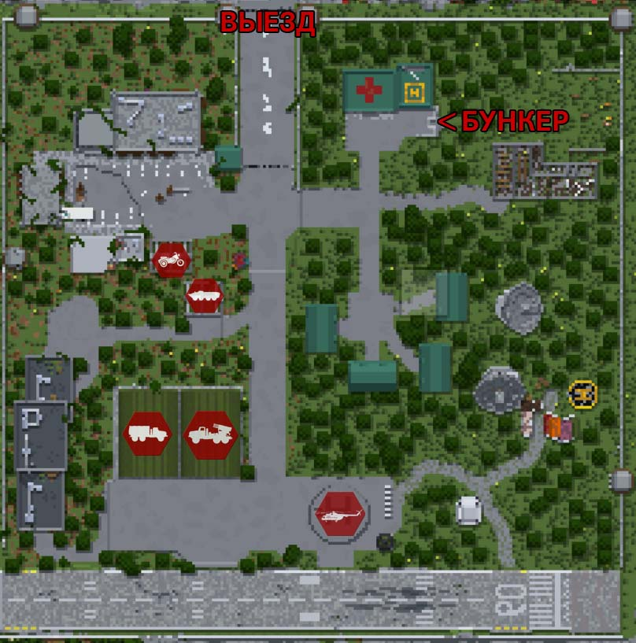
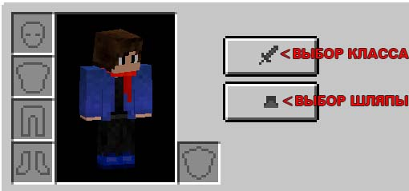
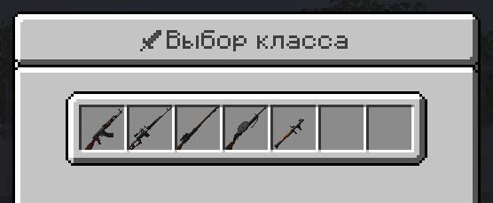
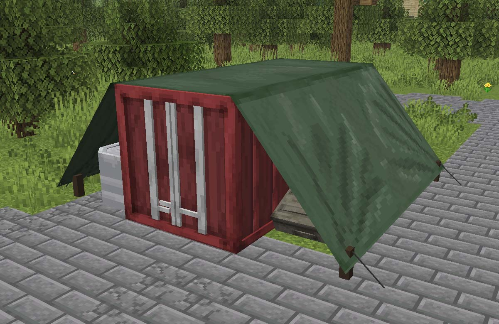
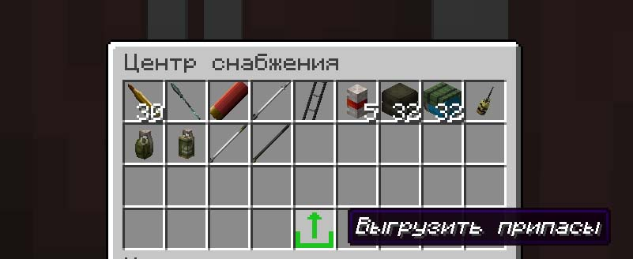
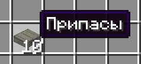
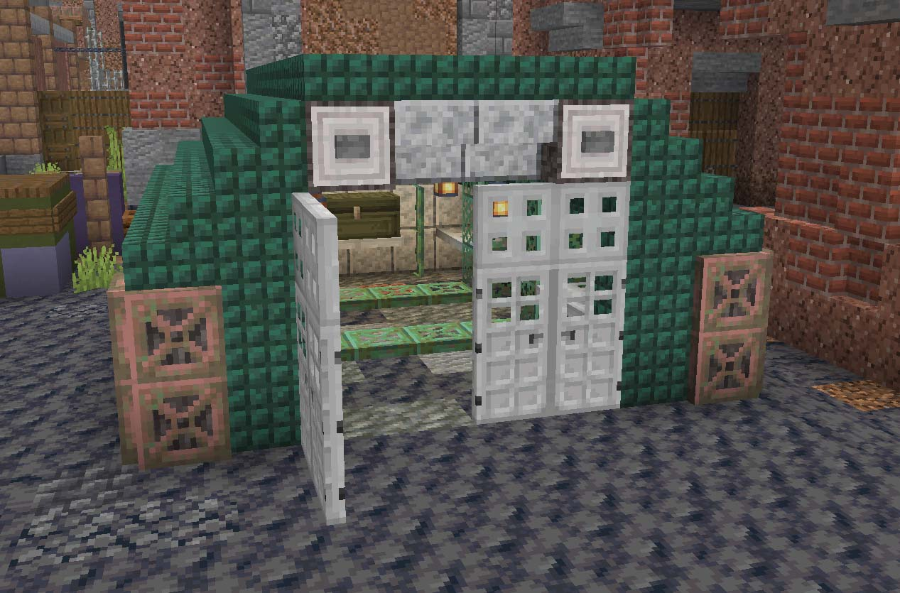
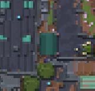
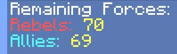

# Ход игры
2 команды начинают на своих **базах**.

На базе имеются:
1. Карта для телепортации на хабы и высадки на точки захвата
2. Сундук с предметами для установки хаба (зависит от режима)
3. Ангары с транспортом

В инвентаре игрок может выбрать *класс* и *шляпу*. Также это можно сделать командами */class* и */hats*

**Классы**

В бункере на главной базе игрокам доступен выбор классов
На данный момент на Ивне есть следующие классы: Стрелок, Младший Снайпер, Старший Снайпер, Пулеметчик, Гранатомётчик.

Всего может быть 1 человек с уникальным классом на команду, кроме **стрелка**. **Стрелков** может быть бесконечное количество

**Центры снабжения**

В **центрах снабжения** покупаются предметы за **припасы**, и в них выгружаются припасы для начисления команде.

Меню центра снабжения:

**Припасы**
Припасы - предмет, находящийся на складах. Его можно выгрузить в центр снабжения для начисления ощего количества припасов команде чтобы покупать предметы. С ними запрещено телепортироваться на базу хабами и точками захвата. Единственный путь - везти их *грузовиками* или *грузовыми вертолетами*.

Пример типового склада:

Типовой склад на карте:

**Резервы**:

**Резервы** - общие жизни команды
После смерти игрока тратится 1 резерв команды.
После траты всех **резервов** команда не может возрождаться, а также на её базе отключается защита от спавнкилла. Команда проигрывает, если все оставшиеся игроки умрут.

После вывода сообщения о победе игра считается законченной.