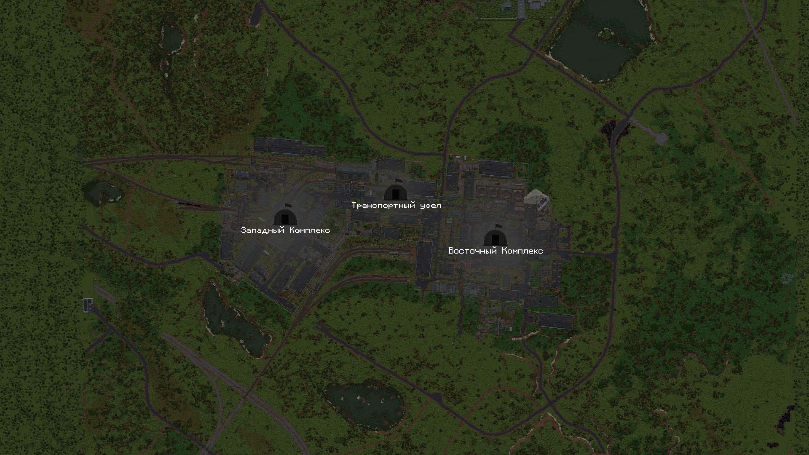
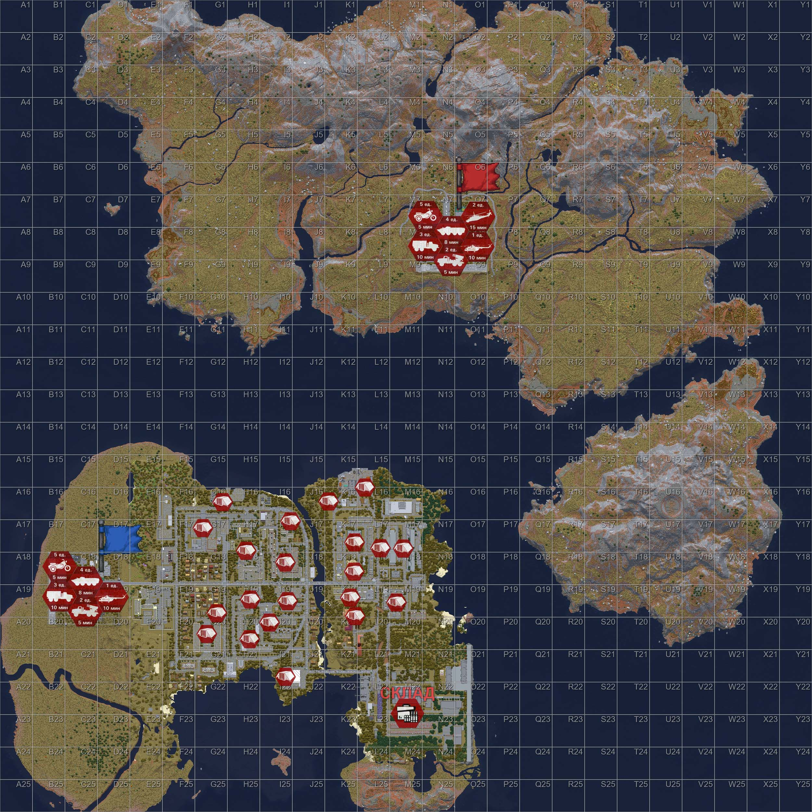

# РЕЖИМЫ ИГРЫ

## Захват точек

Время матча: 100 минут

На карте есть точки для захвата, их радиус отображается на карте. Если в этом радиусе есть игроки команды - этой точке добавляется захват этой командой. При достижении 85% захваченности на точку можно десантироваться, нажав ПКМ по ней на большой карте на базе. Изменения статуса точек пишутся в чат. 

**Побеждает та команда, у которой по истечении таймера больше захвачено точек.**

## Оборона города

Время раунда: 50 минут. 2 раунда со сменой сторон

В городе есть вероятные места появления *центров снабжения*, в части из них с началом игры появляются *центры снабжения*. Есть одно большое здание **склада**. У команды Обороны на базе *нету центра снабжения и боевого вертолета*.
Задача Обороны - возить со склада припасы на центры снабжения, покупать ракеты ПЗРК и прикрывать центры снабжения.
Задача Атаки - разведкой выявить расположения центров снабжения и уничтожить их.

После уничтожения всех центров снабжения **резервы** команды Обороны **сбрасываются до 0** *(и убирается защита от спавнкилла на их базе)*.
Единственная точка для захвата - **База Обороны**. После её захвата команда Атаки побеждает.

**Победа Атаки наступает при уничтожении всех центров снабжения и захвате базы Обороны**
**Победа Обороны наступает если она продержится до окончания таймера**

