# Механики

## Карта
*Предмет*. Отображает позицию игрока, тиммейтов, точки захвата и метки.
Можно ставить свои метки на ПКМ.
Можно выключить отображение вышеперечисленного на Q.

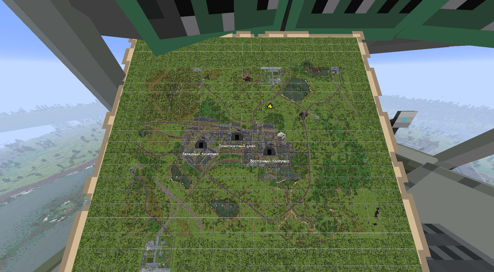

## Хабы

**Предмет установки хаба** находится в сундуке на базе. Также в нем есть сундук, спавнящий припасы **внутри хаба**
Для работы сундука с припасами его нужно поставить внутри хаба.
Для размещения **хаба** надо ждать некоторое время, стоя на шифте на открытом месте.
Для телепорта на **хаб** надо нажать на него на карте на базе.
Работоспособность **хаба** зависит от его целостности. Его можно восстанавливать.

Для возвращения с **хаба** на главную базу надо в хабе зажать шифт и смотреть в пол.

## Оружие

У каждого класса свое уникальное оружие.

У снарядов есть гравитация (баллистика)

Клавиши:
**ПКМ** - стрельба
**SHIFT** - прицел
**C** - зум (по умолчанию)
**СКМ (Колёсико)** - поставить метку
**F** - перезарядка
**Q** - смена режима стрельбы (автоматический/одиночный)

## Физический транспорт

Транспорт призывается в ангарах с помощью зажатия клавиши **SHIFT**.
В ангарах есть запас транспорта, который со временем пополняется. 
Любой транспорт можно уничтожить пулями. Вертолеты и БТРы не пропускают пули по их пассажирам, остальной транспорт может прошиваться.

Езда и поворот на всем наземном транспорте осуществляется на **WASD** на водительском месте.
#### Мотоцикл
Имеет 2 места - водительское и коляску

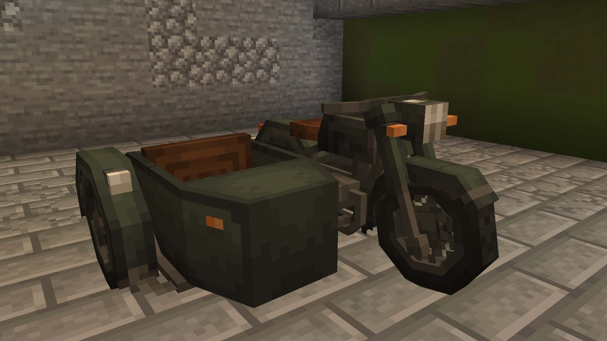

#### Грузовик
Имеет 2 места, можно загрузить ракеты в кузов на ПКМ

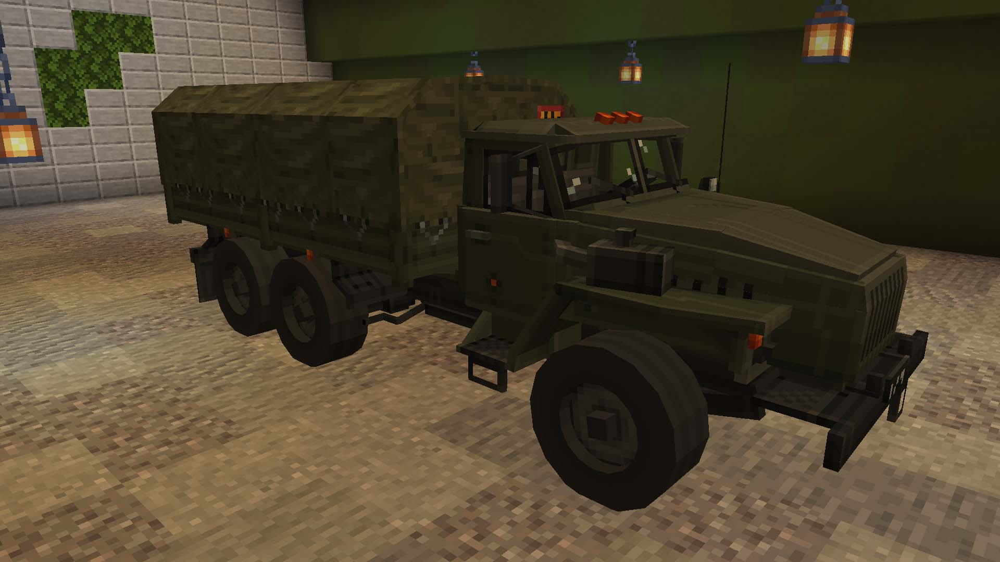

#### РСЗО
Управление пусковой установкой - **WASD** на пассажирском сиденье.
Стрелять - пробел на пассажирском сиденье.
Ракеты загружаются на ПКМ по пусковой установке.
Квадрат прилета отображается при наводке (рельеф и здания учитываются)

Использует исключительно ракеты РСЗО.

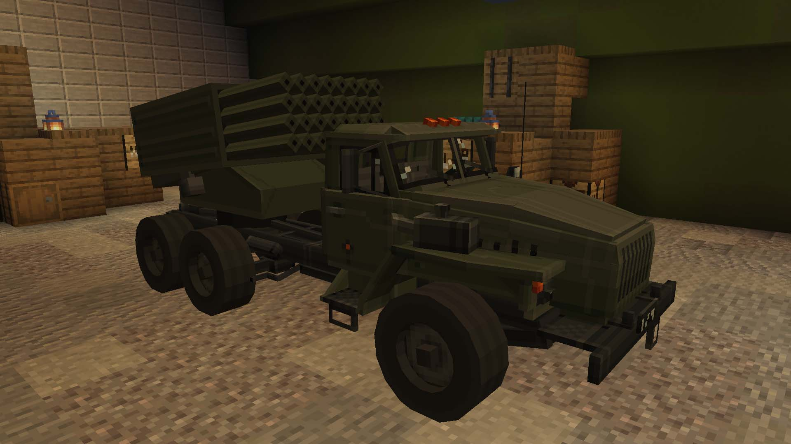

#### БТР
Пуленепробиваемый, уничтожается только с помощью РПГ или ПЗРК.
Умеет плавать.

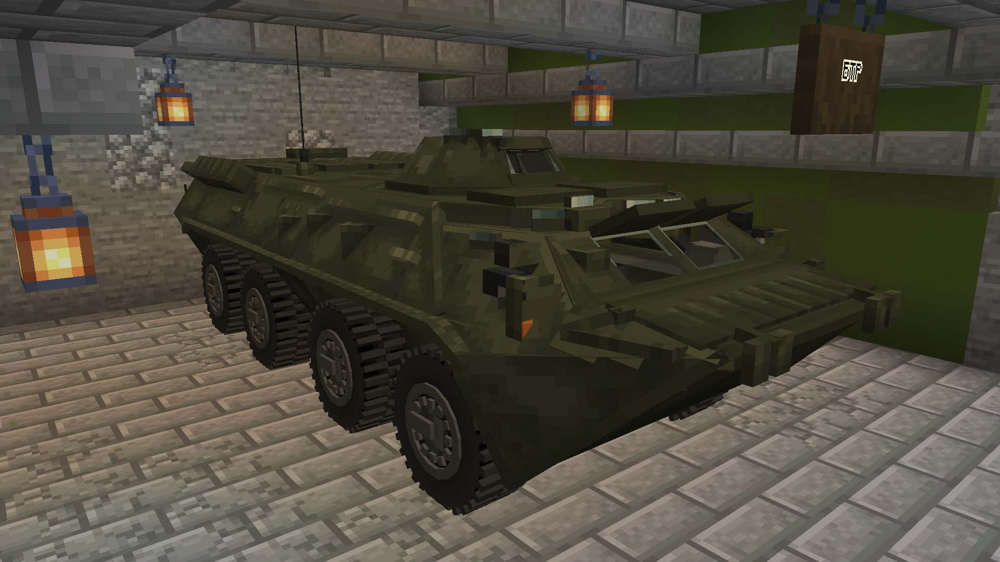

#### Вертолеты

**Грузовой**: 
Имеет 8 мест и 2 отсека для ресурсов. Также на высоте от 20м можно выпустить крюк по нажатию пробела, на который можно нацепить наземный транспорт.

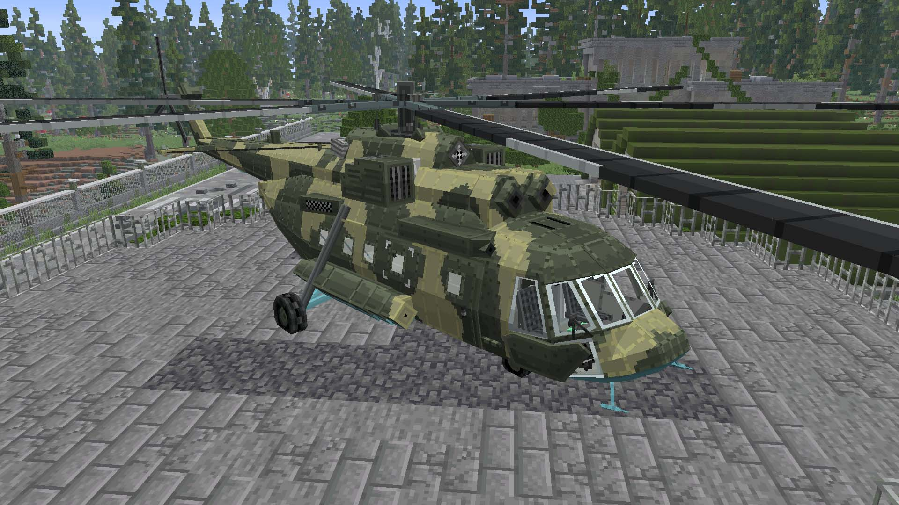

Грузовой вертолет с подцепленным на трос Градом
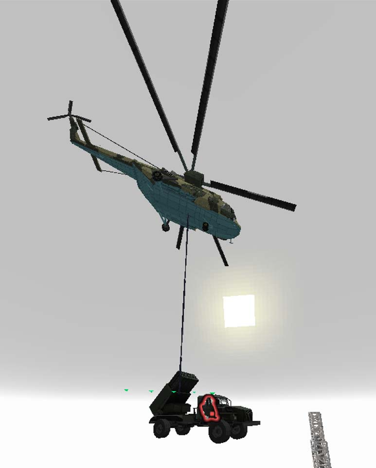

**Боевой**:
Имеет места пилота и стрелка. Стрелок может выпускать авиационные ракеты на пробел.

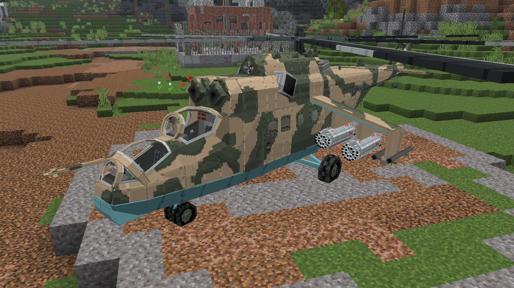

**Управление**:
Управлять вертолетом можно только с места пилота.
При наводке *ПЗРК* на вертолет в нем срабатывает сирена. При непосредственном пуске *ракеты ПЗРК* тон сирены меняется.

**W** / **S** - изменить мощность винта (взлет / снижение).
**A** / **D** - наклон влево и вправо.

**Поворот Мышью** - наклон(вперед/назад) и поворот вертолета.

**Пробел** - выпустить крюк (Грузовой вертолёт, высота 20+ метров) / запустить ракету (Боевой вертолёт, с места стрелка)

**Двойной пробел** - выпустить тепловые ловушки (сбивают наводку ракеты ПЗРК)

Тепловые ловушки и промахнувшаяся благодаря ним ракета ПЗРК:
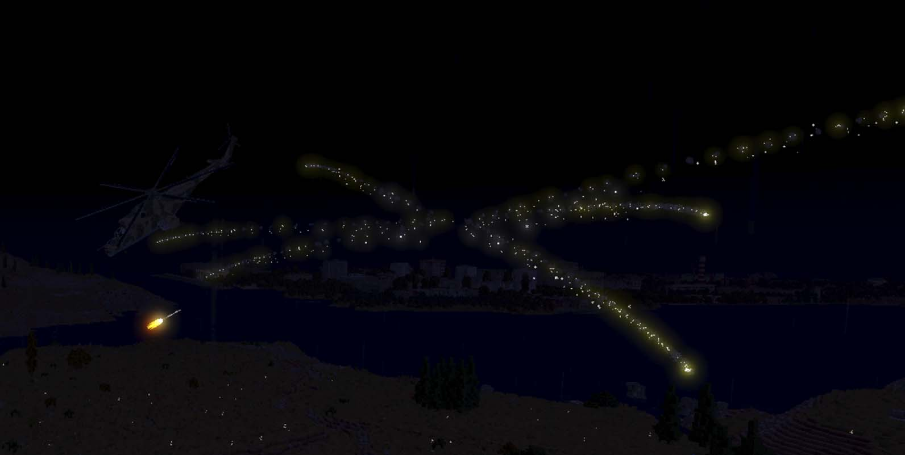

#### Лестницы
Приобретаются в *центре снабжения*. Ставятся на землю. Позволяют залазить на высоту до 12м.

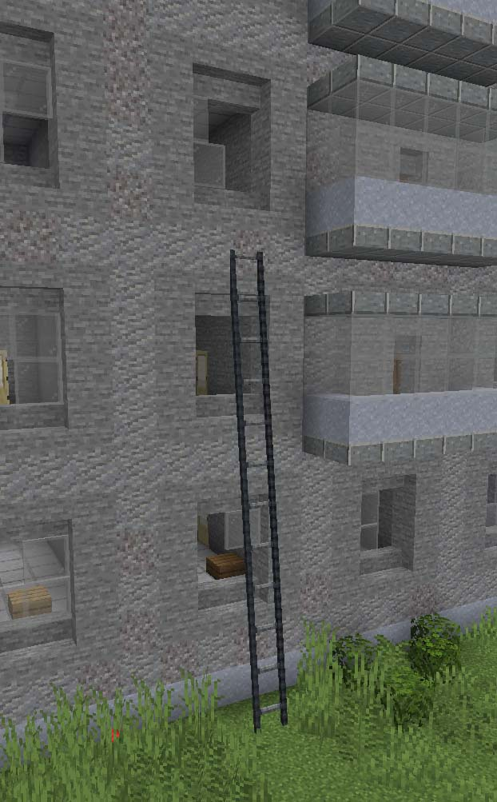

#### Понтонные мосты
Приобретаются в *центре снабжения*. Устанавливаются на воду как блоки.
Позволяют провозить технику через реки и водоемы. Альтернатива при уничтоженных мостах

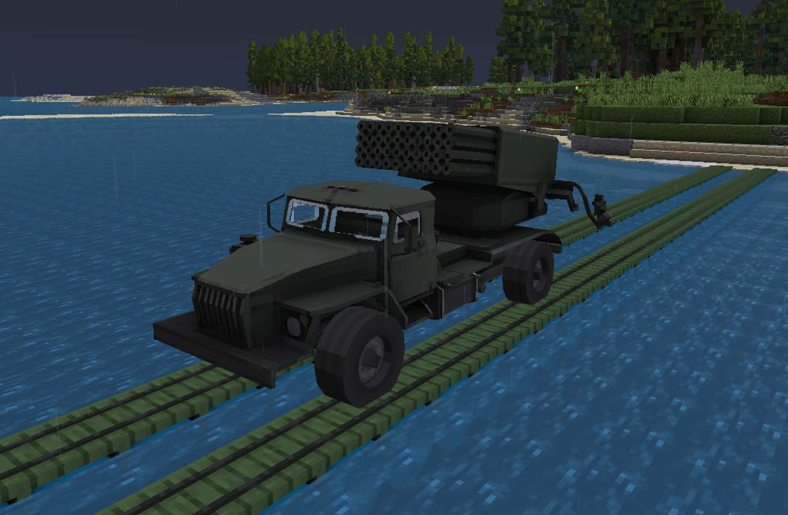

#### Взрывчатка
Приобретается в *центре снабжения*. Устанавливается на блоки и транспорт. При использовании детонатора взрывается вся установленная вами взрывчатка в радиусе 150м.

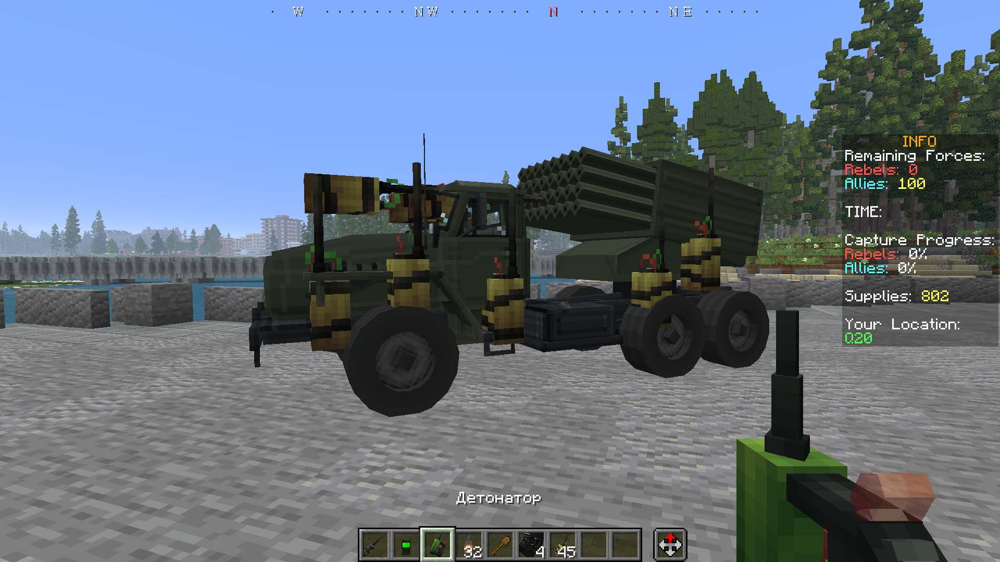